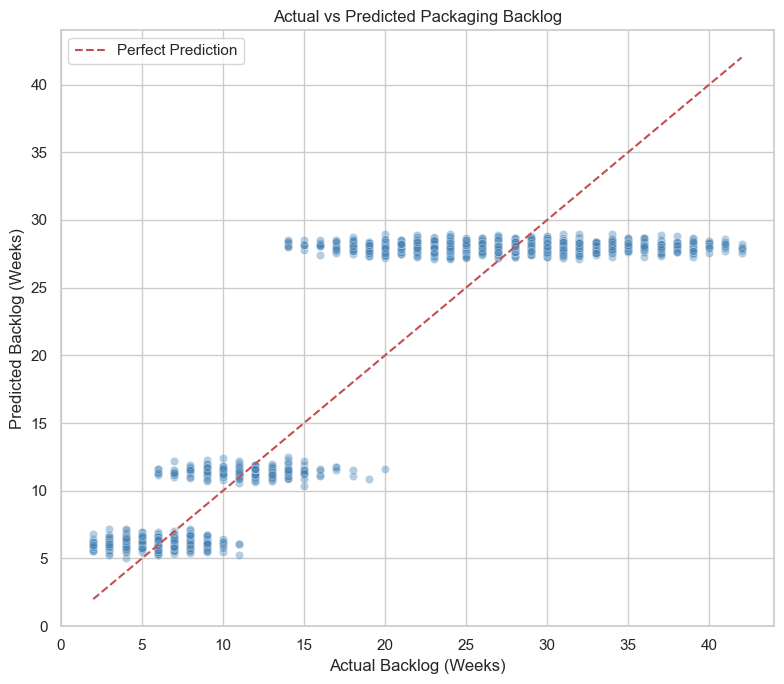

# AI Semiconductor Supply Chain Analytics & Packaging Backlog Prediction

**Project objective:** Identify semiconductor chips production bottlenecks, assess operational risk, and predict packaging delays to support capacity planning amid rising demand.

**Interactive Tableau dashboard:** [Supply chain operations overview](https://public.tableau.com/views/AISemiconductorSupplyChain-OperationsOverview/Dashboard1-AISemiconductorSupplyChain-OperationsOverview?:language=en-US&:sid=&:redirect=auth&:display_count=n&:origin=viz_share_link)

> **Note**: This project utilizes synthetic data for demonstration purposes.

---

## Business Context

The rapid expansion of AI infrastructure has increased the demand for manufacturing semiconductor chips. As production volumes increase, packaging backlogs are a key contributor to supply chain bottlenecks affecting delivery timelines.

This project analyzes a semiconductor chips supply chain dataset using **exploratory data analysis, regression models, and data visualization** to identify factors contributing to packaging backlogs and develop a machine learning model to predict packaging backlog duration.

- Analyze backlog patterns across manufacturing facilities, geographic regions, and packaging technologies to identify operational constraints.
- Investigate how manufacturing capacity, facility utilization, process technology, and other operational factors influence packaging delays.
- Build, evaluate and compare regression models to predict packaging backlog duration.
- Compare regression model performance against a simple packaging-type average baseline.
- Use Tableau to monitor bottlenecks, assess facility performance, and support capacity planning.

## Executive Summary

- This project analyzes semiconductor chips supply chain operations to identify production bottlenecks, assess supply chain risks, and predict packaging delays. Using Python, regression models, and Tableau, the analysis combines manufacturing performance metrics with predictive analytics to understand where operational constraints occur.

- The project includes an interactive Tableau dashboard that examines wafer capacity, utilization, production yield, packaging backlogs, and supply chain vulnerabilities. Python regression models are used separately to estimate packaging backlog duration.

- The analysis helps operations managers monitor supply chain performance and investigate potential packaging delays. These insights support data-driven capacity planning and operational decision-making.

## Methodology

**Step 1: Data Preprocessing:**

Cleaned and validated semiconductor chips supply chain data by checking missing values, duplicates, and inconsistencies to ensure data quality for analysis and predictive modeling.

**Step 2: Exploratory Data Analysis (EDA):**

Analyzed wafer capacity, facility utilization, packaging backlogs, and manufacturing characteristics to identify production bottlenecks and potential supply chain risks.

**Step 3: Predictive Modeling:**

Built and compared regression models, including Bayesian Ridge, LightGBM, and CatBoost, to predict packaging backlog duration. Evaluated model performance using MAE, RMSE, and R².

**Step 4: Model Validation:**

Compared the selected regression model against a packaging-type average baseline to determine whether additional manufacturing characteristics improved predictive accuracy.

**Step 5: Data Visualization:**

Created an interactive Tableau dashboard to visualize manufacturing performance, packaging backlogs, and supply chain vulnerabilities.

## Key Findings

### 1. Advanced Packaging Technologies Experience the Longest Delays

Analysis of **10,000 semiconductor facility records** revealed a relationship between packaging backlog and packaging technologies.

Advanced packaging technologies such as **CoWoS and Foveros-3D experience approximately 4–5 times longer backlogs** than standard packaging in the synthetic dataset, highlighting potential capacity constraints in the modeled packaging operations.

<p align="center">
  
</p>

### 2. Advanced Process Nodes Face Higher Packaging Backlogs

Manufacturing facilities using **2nm–5nm process nodes** experienced average packaging backlogs of approximately **24 weeks**, compared with 10–13 weeks for 7nm–28nm nodes in the synthetic dataset.

This suggests that facilities supporting advanced semiconductor manufacturing face greater packaging delays in the modeled data, making them important areas for operational monitoring and capacity planning.

### 3. Regression Models Explain Approximately 81% of Backlog Variation

Three regression models were evaluated using five-fold cross-validation to predict packaging backlog duration.

| Model | MAE (Weeks) | RMSE (Weeks) | R² |
|---|---:|---:|---:|
| Bayesian Ridge | 3.53 | 4.63 | 0.8079 |
| CatBoost | 3.55 | 4.65 | 0.8067 |
| LightGBM | 3.61 | 4.73 | 0.7999 |

**Bayesian Ridge achieved the best performance among the three regression models in cross-validation**, with a holdout test R² of **0.806** and an MAE of **3.51 weeks**.

However, a simpler packaging-type average baseline slightly outperformed Bayesian Ridge on the same holdout test set:

| Model | RMSE (Weeks) | R² |
|---|---:|---:|
| Packaging-type average baseline | **4.6327** | **0.8073** |
| Bayesian Ridge | 4.6425 | 0.8065 |

The results demonstrate that regression models can estimate packaging backlog duration using manufacturing and product characteristics, but additional model complexity did not improve accuracy over the simple baseline in this test.

<p align="center">
  
</p>

### 4. Packaging Technology Is the Strongest Predictor of Backlog

Permutation feature importance identified **advanced packaging type** as the most influential variable in the selected regression model, substantially exceeding the contribution of other manufacturing characteristics.

This indicates that the type of packaging technology is a major factor associated with backlog duration in the dataset.

### End-to-End Analytical Workflow

```text
Semiconductor Supply Chain Dataset
             |
             v
      Data Preprocessing
             |
       +-----+------+
       |            |
       v            v
 Descriptive &   Regression Model
 Risk Analysis   Training/Evaluation
       |            |
       v            v
 Tableau         Backlog Prediction
 Dashboard       & Model Validation
```

## Tools & Technical Skills

| Area | Tools and methods |
|---|---|
| Programming | Python, Pandas, NumPy, Seaborn, Matplotlib, scikit-learn |
| Visualization | Tableau, KPI design |
| Predictive analytics | Regression modeling, gradient-boosted decision trees |
| Model evaluation | MAE, RMSE, R² |
| Supply chain analytics | Capacity utilization, bottleneck analysis, vulnerability assessment |
